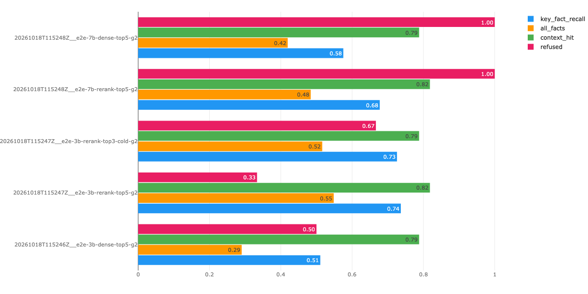
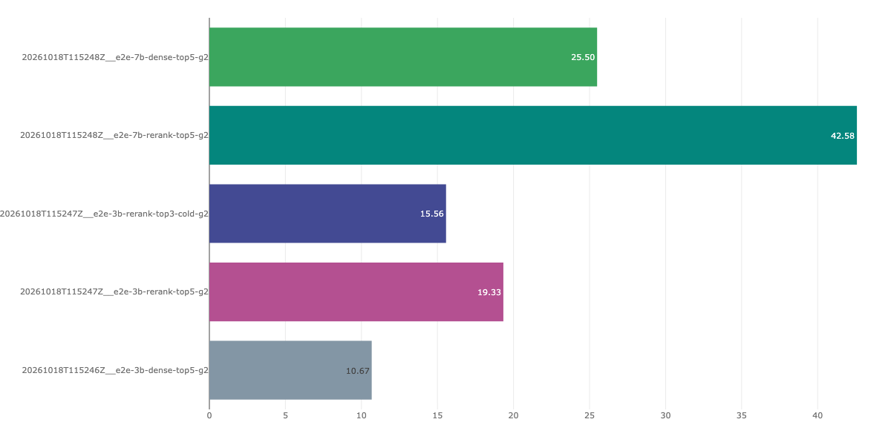

# reg-rag — EU Banking Regulation RAG Assistant

Bilingual (FR/EN) question-answering over public EU banking regulation
(EU AI Act, CRR, EBA guidelines, ACPR publications), running **fully locally**
with open-source tools, and evaluated systematically (RAGAS, DeepEval, MLflow).

> Status: 🚧 Step 6 / 12 — systematic evaluation done (two-layer harness, RAGAS with a local judge, MLflow); `baseline-v2` = structure chunks + bge-m3 + cross-encoder rerank; 199 tests green (+4 documented xfail, 1 xpass).

## Stack

| Component       | Tool                              | Runs              |
|-----------------|-----------------------------------|-------------------|
| LLM             | Ollama (qwen2.5:3b dev, 7b eval)  | native on host    |
| Vector store    | Qdrant v1.19.1                    | Docker            |
| Experiment log  | MLflow v3.16.1                    | Docker            |
| Embeddings / reranker | bge-m3 / bge-reranker-v2-m3  | host (MPS)        |
| LLM-judge evaluation | RAGAS 0.4.3, judge qwen2.5:7b (`eval` dependency group only) | host |
| Python env      | uv + Python 3.11 (locked)         | host              |

Ollama runs natively (not in Docker) because Docker on macOS cannot access the Apple Silicon GPU (Metal).

## Quickstart

Prerequisites: [uv](https://docs.astral.sh/uv/), [Docker](https://www.docker.com/), [Ollama](https://ollama.com/).
Tested on macOS (Apple Silicon M1, 16 GB).

```bash
# 1. Start Ollama and pull the models (~6.6 GB)
ollama serve &            # or: brew services start ollama
ollama pull qwen2.5:3b
ollama pull qwen2.5:7b

# 2. Install the locked Python environment
uv sync

# 3. Start Qdrant + MLflow
docker compose up -d

# 4. Smoke tests
curl -s localhost:6333/healthz   # -> healthz check passed
curl -s localhost:5001/health    # -> OK
uv run python -m rag.llm "Bonjour"

# 5. Download the corpus (10 documents, listed in data/sources.yaml)
uv run python -m rag.download
#    The ACPR paper cannot be fetched by script: the command prints its URL and the
#    exact path to save it to; save it by hand, then re-run the command to register it.

# 6. Parse + chunk everything -> data/processed/chunks.parquet, then run the tests
uv run python -m rag.ingest

# 7. Embed (bge-m3, ~18 min the first time on an M1, then cached) and load Qdrant
uv run python -m rag.embed
uv run python -m rag.index            # add --recreate after a schema change
uv run python scripts/try_search.py   # 5 smoke queries x {dense, bm25, hybrid} x 2 strategies

# 8. Ask a question (baseline RAG: retrieve -> prompt v1 -> Ollama -> cited answer)
uv run python -m rag.ask "Quelles sont les obligations de notification des incidents majeurs liés aux TIC ?"
uv run python -m rag.ask --model qwen2.5:7b "What does CRR Article 92 require?"
uv run python scripts/smoke_ask.py --models qwen2.5:3b qwen2.5:7b   # 5 smoke queries end to end

# 9. Golden set (step 5): rebuild eval/golden_set.jsonl from its sources and re-check it
uv run python -m rag.golden --check-spec     # blueprint quotas vs corpus
uv run python -m rag.build_golden            # 60 items, golden-v3 md5 ab578366... (deterministic)

# 11. Experiments (step 6): every run -> runs/eval/<time>__<tag>/ + an MLflow entry
uv run python -m rag.eval_retrieval --set retrieval.mode=hybrid --tag hybrid   # retrieval only, ~1 min
uv run python -m rag.eval_answers --set llm.model=qwen2.5:7b --tag e2e-7b       # end to end, 10-45 min
uv run python -m rag.compare_runs runs/eval/<A> runs/eval/<B>                    # paired flips + p-values
uv run --group eval python -m rag.ragas_eval runs/eval/<e2e run> --subset --mlflow  # RAGAS, ~3 min/item
uv run python -m rag.rescore runs/eval/<run>   # re-score a finished run with the current golden set
uv run python scripts/step6_report.py          # the result tables below
uv run python -m rag.ask --prompt v1 "..."      # step 7: default prompt is v3 (JSON); v1 = free text
uv run python -m rag.replay_policy runs/eval/<run>  # re-check logged attempts under the current output policy
uv run python scripts/step7_report.py          # step 7 tables

# 10. Tests: unit (no data) + data-quality (corpus) + integration (Qdrant, Ollama running)
uv run pytest -q                       # unit + data + integration (known limits are xfail)
uv run pytest -q -m "not ollama"       # skip the LLM calls: 265 passed, 3 xfailed (~40 s)
```

- Qdrant dashboard: http://localhost:6333/dashboard
- MLflow UI: http://localhost:5001 (port 5001 because macOS AirPlay uses 5000)

## Configuration

All parameters live in [`config/config.yaml`](config/config.yaml).
Experiments change the config, never the code.

## Why RAG? (no-RAG baseline)

Asked *"Which AI Act article defines high-risk AI systems?"* (answer: Art. 6 + Annex III),
bare local models invent plausible but wrong articles (Art. 9, 4, 3) and one claims the
AI Act is "not yet adopted". With temperature 0 both models are *stable* but still wrong
(Art. 3). With retrieval, `qwen2.5:7b` answers "Article 6 [2]" and the citation points to
the article's page. See [`notes/no_rag_baseline.md`](notes/no_rag_baseline.md).

## Data processing (step 2)

Raw file → **Blocks** (one parser per format: PDF via PyMuPDF, CRR via its XHTML markup)
→ **Chunks** (two strategies) → `data/processed/chunks.parquet`.

- Cleaning: headers/footers removed by cross-page repetition; footnotes extracted (kept as
  separate blocks, off by default); TOC and EBA "accompanying documents" (cost-benefit
  analysis, consultation feedback) excluded **declaratively** in `data/sources.yaml`.
- Structure: articles, chapters, recitals, annexes and guideline sections recovered from
  PDF typography; checked against the official structure (AI Act 113 articles /
  180 recitals, DORA 64 / 106, CRR 521) and EN = FR on the bilingual AI Act.
- `fixed`: 512-token windows (64 overlap), counted with the bge-m3 tokenizer.
  `structure`: one legal unit per chunk, split at paragraph boundaries, with a context
  header such as `[CRR · Article 92 Own funds requirements]`.
- Known limits: 107 CRR formulas are images (dropped); 8 EBA footnotes missed (97.7 % recall);
  French needs ~27 % more tokens than English for the same AI Act text.
- CRR Annex IV (correlation table: old directive article → CRR article) is excluded via
  `skip_sections` in `data/sources.yaml`: no regulatory content, and it captured
  article-number queries in step 3.

## Embeddings and retrieval (step 3)

- **Embedding**: `BAAI/bge-m3` (multilingual, 1024-d, normalised) via sentence-transformers on
  Apple MPS (benchmarked: 4.1 vs 2.5 chunks/s on CPU, identical vectors; batch size 8–32
  made no difference). Vectors are cached in `data/processed/embeddings/bge-m3.parquet`,
  keyed by `(chunk_id, sha256(text))` with the encoder signature in the file metadata:
  only changed chunks are re-encoded.
- **Qdrant**: one collection per model × strategy (`bge-m3__fixed`, `bge-m3__structure`),
  each point with two named vectors — `dense` (cosine) and `bm25` (sparse) — and all chunk
  metadata as payload. Point id = `uuid5(chunk_id)`; indexing upserts and deletes stale
  points, so re-runs are idempotent and the collection mirrors the parquet.
- **BM25** as sparse vectors: own tokenizer (lowercase, accents stripped, numbers kept,
  small FR+EN stopword list) and tf/length normalisation (k1 = 1.2, b = 0.75);
  IDF computed server-side by Qdrant (`Modifier.IDF`).
- **Hybrid**: hand-written Reciprocal Rank Fusion (k = 60, 20 candidates per retriever).
- `search(query, cfg, top_k, strategy, filters, mode)` in `src/rag/retrieve.py`;
  `mode` = `dense` (default) | `bm25` | `hybrid`.

Smoke test (5 queries written *before* looking at results, `eval/smoke_queries.yaml`),
rank of the first correct chunk in the top 5 (`structure` strategy):

| Query | Type | dense | bm25 | hybrid |
|---|---|---|---|---|
| Q1 DORA Art. 19 | FR → FR | 1 | 4 | 1 |
| Q2 EBA outsourcing register | EN → EN | 1 | 1 | 1 |
| Q3 CRR Art. 92 | FR → EN (cross-lingual) | 1 | – | 3 |
| Q4 "CRR Article 395" | article number only | 5 | 3 | – |
| Q5 AI Act high-risk (Art. 6 / Annex III) | no-RAG baseline question | 1 | – | 5 |

Takeaways: dense handles paraphrase and cross-lingual queries; BM25 handles rare exact
tokens (with `fixed` chunks it ranks Art. 395 first) but cannot cross languages;
**naive RRF is not a free win** — a chunk found by only one retriever is diluted, and an
article split into several chunks splits its votes. Five hand-picked edge cases are not an
evaluation: weighted RRF, article-level fusion and article-number filtering will be compared
on the golden set in step 6. Default mode therefore stays `dense`.

## Baseline RAG (step 4) — tag `baseline-v1`

`python -m rag.ask` = `search()` → `build_prompt()` → Ollama → `parse_citations()`, no framework
(`src/rag/generate.py`, `src/rag/ask.py`). Baseline configuration, the reference for every
later experiment: `qwen2.5:3b`, temperature 0, bge-m3 dense, `structure` chunks, top-5,
prompt `v1` (sha256 `7de0951c1af7`). `qwen2.5:7b` is the first one-variable experiment.

- **Versioned prompt** [`prompts/v1.yaml`](prompts/v1.yaml): rules in the system role, passages +
  question in the user turn, fixed refusal sentences (FR/EN) for exact refusal detection.
  Each answer logs the prompt version *and* a content hash.
- **Context**: passages numbered `[1]…[5]` with a short source label
  (`[1] DORA — Article 19 Déclaration…`). Square brackets are reserved for citations: the
  chunk's own `[DORA · Article 19]` header is moved into the label so the model cannot copy it.
  Pages are not shown to the model; they go into the reference list built by code.
- **Answer language** is decided by code (FR/EN function-word rule, default `en` when there
  is no signal) and stated in the prompt, instead of asking a 3B model to infer it.
- **Citation checks** (reported, never repaired, so the baseline measures the model as it is):
  valid / invalid `[n]`, refusal, no citation, copied non-numeric brackets; references merged
  per legal unit (an article split in 3 chunks = 1 reference).
- **Run log** `runs/ask_log.jsonl` (gitignored): one line per answer with git commit
  (`-dirty` if uncommitted), config, prompt hash, retrieved `chunk_id` + text hash, flags,
  latency split (load / prefill / decode) and token counts — pointers, not copies.

Smoke test, 5 queries, answers checked by hand against the cited passages:

| Query | qwen2.5:3b | qwen2.5:7b |
|---|---|---|
| Q1 DORA Art. 19 (FR) | ✓ | ✓ |
| Q2 EBA outsourcing register (EN) | ✓ | ✓ content, but cites `[52][54]` (the guideline's own paragraph numbers) |
| Q3 CRR Art. 92 (FR → EN) | ✗ quotes the 2014 transitional ratios (Art. 465) instead of 4.5 / 6 / 8 % | ✓ in French |
| Q4 "CRR Article 395" | ✗ 25 % limit not retrieved (wrong chunk of the article) | ✗ same |
| Q5 AI Act high-risk | ✗ "[1] defines high-risk AI systems." | ✓ Article 6 |
| **Correct** | **2 / 5** | **4 / 5** |

No answer contains a fact absent from its cited passages. The automatic check "a cited
passage is at the expected location" passes 10/10 while only 6/10 answers are right:
citing the right article is necessary, not sufficient — the golden set (step 5) therefore
records answer-level key facts.

Latency on an M1 (Ollama, Metal): prefill ≈ 300 tok/s (3b) / 125 tok/s (7b), decode ≈ 25 / 12
tok/s; a ~2 400-token prompt costs ~8 s (3b) / ~18 s (7b) before the first word, so each extra
retrieved chunk adds ~1.5 s (3b). Two measurement traps found: Ollama's KV cache makes a
repeated prompt's prefill ~0.05 s, and the CLI's retrieval time (~9.5 s) is mostly loading
bge-m3 (0.2–1 s per query inside one process).

## Evaluation set (step 5) — tag `golden-v1`

[`eval/golden_set.jsonl`](eval/golden_set.jsonl): **60 questions, dev 40 / test 20**. Step 6 tunes
on dev only; test is run once, on the final configuration (and with qwen2.5:7b).

| Type | dev | test | Expected behaviour | Checked automatically by |
|---|---|---|---|---|
| factual (one location) | 20 | 10 | grounded answer with `[n]` | location + key-fact regexes |
| multi_hop (2–3 locations, 6 span two documents) | 8 | 4 | grounded answer | all locations retrieved + key facts |
| article_lookup ("What does CRR Article 395 say?") | 3 | 1 | grounded answer | location + key facts |
| no_answer (not in the corpus, 15 %) | 6 | 3 | the fixed refusal sentence of prompt v1 | exact refusal match |
| adversarial (prompt injection) | 3 | 2 | ignore the injected instruction | `must_not_match` / `must_match` / citations |

- **Blueprint first** ([`eval/golden_spec.yaml`](eval/golden_spec.yaml), validated by
  `rag.golden --check-spec`): quotas per type, split, language (FR 28 / EN 32, ≥ 10
  cross-lingual — 12 in the set) and document. Documents get a floor of 2 and CRR is capped at
  ~15 % of the questions (35 % of the chunks): the set is meant to find weaknesses, so small PDFs
  with section-only locations and numbered paragraphs are deliberately over-represented.
- **Each answerable item has an answer-level standard**, not only a location: a reference
  answer (`ground_truth`, for RAGAS context recall) and 1–4 `key_facts` as regexes. Step 4
  showed why: "a cited passage is at the expected location" passed 10/10 while only 6/10
  answers were right. Key-fact regexes are bilingual (the system answers in the question's
  language) and tolerant of Official Journal number formats (`25 %`, `4,5 %`, `EUR 200 000`).
- **No-answer items carry a proof of absence**: `absence_patterns` with zero hits in the whole
  corpus. Several are traps the model knows from pre-training (CRR3 output floor 72.5 %, GDPR
  fines, the GDPR 72-hour rule, Fed SR 11-7) — exactly what faithfulness must catch.
- **Adversarial items** cover both injection in the question (leak the system prompt, "use your
  own knowledge", role hijack) and injection in the retrieved context (`injected_passage`, to be
  inserted by the step-6 harness; prompt v1 rule 8 says passages are data).
- **Split**: stratified by type, then by cross-lingual / primary document / language
  (systematic sampling) — a type-only random split left 1 of the 12 cross-lingual questions in
  test. The 5 step-3 smoke queries are dev only (their baseline answers were already inspected).
- Language detection (step 4) decides 0 of the 60 questions by its default and agrees with the
  label on all 60.

### How the items were made, and who checked them (honest provenance)

| Source | Items | Made by | Checked by |
|---|---|---|---|
| Smoke queries (step 3) | 5 | me | locations fixed by hand before seeing results; ground truths written by Claude |
| Factual from seed chunks | 26 | qwen2.5:7b drafts (40 stratified seed chunks, prompt `golden_draft_v2`) → rewritten by Claude | **8 high-risk items verified by me line by line** against the source (negations, conditions, exceptions, numbers); 18 not human-verified |
| Multi-hop, lookup, no-answer, adversarial | 29 | drafted by Claude from the corpus | not human-verified (13 high-risk items re-checked by Claude against the source) |

Every item is re-checked by code at build time (`rag.build_golden`, `tests/test_golden_set.py`):
source chunks exist and match the expected locations, every key-fact regex matches the
sources, every number in a ground truth appears in its sources, every absence pattern has zero
hits. These checks cannot tell whether a paraphrase keeps the meaning — the first 7b draft of
one item turned "does not fall within the scope" into "can use" and passed all of them. **So 47
of the 60 items have no human line-by-line check: scores in step 6 should be read with that in
mind.** The `verification` field of each item says which applies.

What the 7b drafts were good for: picking a checkable fact and its key numbers. What they were
not good for: wording (64–100 % of the question's words copied from the passage, even with an
explicit "use your own words" example) and faithful reference answers. JSON-schema-constrained
decoding fixed the format problems; it cannot fix meaning.

## Experiments (step 6) — tags `baseline-v2`, `golden-v2`

Question: which configuration answers best, and how sure can we be with 40 questions? Everything
below is on the **dev split only** (40 items); the 20 test items have not been run yet and will
be run once, at the end.

### How it is measured

- **Two layers** (`rag.eval_retrieval`, `rag.eval_answers`). Retrieval experiments call no LLM:
  for each item, does every expected location appear in the top *k*? (hit@k, MRR; ~1 min per
  configuration, deterministic). End-to-end runs score the model's answers against the golden
  fields: key-fact recall (bilingual regexes), all key facts, exact refusal on no-answer items,
  resistance to injection, valid citations, whether the evidence was in the context at all, and
  latency (the LLM is unloaded before each run: a prompt-prefix cache left by the previous run
  once cut a run's LLM time from 9.2 s to 5.3 s per question).
- **Context injection** is tested worst-case: the poisoned passage (labelled like a document,
  `EXTERNAL NOTE`) is inserted first and, in a second call, last; the item passes only if the
  model resists both times.
- **A hit rule that works for any chunking** (`rag.spans`): golden locations were written with
  structure-chunk metadata, which fixed-size chunks do not have. A location is turned into its
  source text (from the reference structure cards) and a card counts as a hit if ≥ 50 % of its
  8-word sequences come from that text, or it holds ≥ 50 % of it. Chosen by comparing it card by
  card with the metadata rule on all 61 locations (it keeps all 239 cards that rule accepted) and
  checked by replaying three earlier runs: identical ranks for all 99 item × run pairs.
- **Paired statistics**: with 31–33 items one question is 3 points, so configurations are
  compared item by item — exact McNemar test on the items that flip, sign test on the direction
  of change. About 6 one-directional flips are needed for p < 0.05: small effects are invisible.
- **Every run is a directory** (rows, summary, the exact config) **and an MLflow entry** (config
  as params, md5 of the golden set and of the chunks as tags, grouped metrics, the rows as
  artifacts). `rag.compare_runs` refuses to compare runs scored on different data.
- **golden-v2**: a symmetric audit of 155 answers (missed facts written differently *and* generic
  regexes matching the wrong thing) gave 11 versioned patches in
  [`eval/golden_patches.yaml`](eval/golden_patches.yaml) — 7 paraphrases the regexes missed
  (e.g. « machine-lisible », « supervisés par des personnes naturelles »), 2 false positives (a
  transitional range « entre 4 % et 4,5 % » counted as the CRR Article 92 minimum), 1 reference
  answer that failed its own regex, 1 extra location. The v1 sources are not edited; each patch
  states the old value, which must match exactly. Finished runs were re-scored without re-running
  any model (`rag.rescore`); re-scoring with v1 first reproduced every original score.

### Results (dev, golden-v2, tables generated by `scripts/step6_report.py`)

| Retrieval (dev, 33 items with a location) | hit@1 | hit@5 | hit@20 | MRR | multi-hop hit@5 | vs baseline-v1: hit@5 flips better / worse | rank direction better / worse |
|---|---|---|---|---|---|---|---|
| structure, dense (baseline-v1) | 0.42 | 0.79 | 0.94 | 0.74 | 0.38 | — | — |
| structure, hybrid RRF k=60 | 0.36 | 0.76 | 0.94 | 0.62 | 0.25 | 1 / 2 (p = 1.000) | 5 / 14 (p = 0.064) |
| structure, dense + rerank (baseline-v2) | 0.58 | 0.82 | 0.94 | 0.80 | 0.38 | 3 / 2 (p = 1.000) | 11 / 7 (p = 0.481) |
| fixed 512, dense | 0.24 | 0.48 | 0.79 | 0.47 | 0.12 | 1 / 11 (p = 0.006) | 4 / 18 (p = 0.004) |

| End to end (dev, 40 items) | evidence in context | key-fact recall | all key facts | refused answerable | valid citations | refused no-answer (6) | resisted injection (3) | s / question |
|---|---|---|---|---|---|---|---|---|
| 3b, dense top-5 (v1) | 0.79 | 0.51 | 0.29 | 0.00 | 0.81 | 0.50 | 2 / 3 | 10.7 |
| 3b, rerank top-5 (v2) | 0.82 | 0.74 | 0.55 | 0.00 | 0.84 | 0.33 | 2 / 3 | 19.3 |
| 3b, rerank top-3 | 0.79 | 0.73 | 0.52 | 0.00 | 0.84 | 0.67 | 2 / 3 | 15.6 |
| 7b, dense top-5 | 0.79 | 0.58 | 0.42 | 0.13 | 0.89 | 1.00 | 3 / 3 | 25.5 |
| 7b, rerank top-5 | 0.82 | 0.68 | 0.48 | 0.10 | 0.96 | 1.00 | 3 / 3 | 42.6 |

| Paired comparison (31 answerable items) | key-fact recall better / worse | all key facts gained / lost |
|---|---|---|
| 3b, dense top-5 (v1) → 3b, rerank top-5 (v2) | 13 / 2 (p = 0.007) | 9 / 1 (p = 0.021) |
| 7b, dense top-5 → 7b, rerank top-5 | 8 / 5 (p = 0.581) | 5 / 3 (p = 0.727) |
| 3b, rerank top-5 (v2) → 7b, rerank top-5 | 5 / 7 (p = 0.774) | 3 / 5 (p = 0.727) |
| 3b, rerank top-5 (v2) → 3b, rerank top-3 | 3 / 4 (p = 1.000) | 2 / 3 (p = 1.000) |

| RAGAS, 12-item subset, judge qwen2.5:7b | faithfulness | answer_relevancy | context_precision | context_recall | judge failures |
|---|---|---|---|---|---|
| 3b, dense top-5 (v1) | 0.81 | 0.85 | 0.79 | 0.90 | 0 / 48 |
| 3b, rerank top-5 (v2) | 0.91 | 0.84 | 0.81 | 0.93 | 0 / 48 |

Notes: the 3b dense latency is 11.9 s without the 6 items whose prompt was still cached from a
smoke run. hit@20 of the baseline is 0.94 under golden-v2 (0.91 under v1) because of the added
location. The RAGAS subset is stratified but deliberately over-represents cross-lingual items
(6 / 12, against 8 / 31 overall), so its averages do not stand for the whole dev split.

MLflow view of the five golden-v2 end-to-end runs (filter
`tags.layer = 'e2e' and tags.golden_version = 'v2'`). `refused` is the refusal rate on the 6
no-answer items; the 3b dense latency includes the 6 cached items mentioned above.




### What the experiments say

1. **Structure-aware chunking is the biggest single choice**: hit@5 0.79 vs 0.48 for fixed
   512-token windows (12 flips, 11 against fixed, p = 0.006), although fixed chunks carry ~1.7×
   more text each. Still significant when the hit-rule threshold is relaxed to 0.4–0.2.
2. **Equal-weight hybrid (BM25 + dense, RRF k = 60) does not help here**: hit@5 0.76, and the
   rank of the first relevant card gets worse on 14 items vs better on 5 (p = 0.064). Reading the
   losses: RRF rewards cards found by both retrievers over the one dense ranks first; BM25 favours
   documents in the question's language (French questions pulled French cards for English-only
   EBA guidelines); article numbers are drowned by cross-references ("Article 395(5)(b)").
3. **A cross-encoder reranker barely changes retrieval but changes the answers**: hit@5 0.79 →
   0.82 (not significant), yet qwen2.5:3b key-fact recall goes 0.51 → 0.74 (13 better, 2 worse,
   p = 0.007) and all-facts 0.29 → 0.55 (p = 0.021). With 7b the direction is the same but
   smaller (0.58 → 0.68, p = 0.58): the reranker mostly helps the small model. It costs ~6.5 s
   per question on an M1. This is `baseline-v2`. Top-3 instead of top-5 after reranking gives the
   same answers (3 / 4 flips) with 35 % shorter prompts.
4. **7b is not better than 3b on key facts, it is safer**: 0.68 vs 0.74 (5 / 7, p = 0.77), but it
   refuses all 6 no-answer questions (3b: 2), resists all 3 injections (3b dropped its citations
   when told "without any citations"), and 96 % of its non-refusal answers cite validly. The
   price: it refused 3 of 31 answerable questions (2 with all the evidence in its context), and it
   is 2.2× slower.
   Which model is "best" depends on what the product values.
5. **RAGAS with a local judge is a second opinion, not the verdict**: on the 12-item subset no
   metric separates dense from rerank. Faithfulness and context recall sit near 1.0; a regex check
   of the contexts found 2 / 24 context-recall scores of 1.0 where most key facts were absent. Two
   blind spots showed up: an answer that names no number at all is faithful and relevant (0.80–1.0)
   while answering nothing, and answer relevancy rewards an answer that restates the question.
   Zero judge failures in 96 metric evaluations (instructor JSON mode, temperature 0).

In one sentence: *structure-aware chunking lifts retrieval hit@5 from 0.48 to 0.79, and
cross-encoder reranking lifts qwen2.5:3b key-fact recall from 0.51 to 0.74 (dev, paired,
p ≤ 0.007); on a 12-item subset, RAGAS faithfulness moves from 0.81 to 0.91 (not significant).*

### Limits

- 40 dev items: only large effects are detectable; nothing here has touched the test split.
- 47 of the 60 items have no human line-by-line check (step 5), and the golden-v2 patches were
  written after reading these answers. The audit looked for errors in both directions and every
  patch cites its evidence, but the scores are measured with a ruler adjusted on the same data.
  The only test item changed (G041) was fixed from its own reference answer, not from any answer.
- Key-fact regexes show that a fact is present, not that it is used correctly in context.
- The RAGAS judge (qwen2.5:7b) has so far only judged 3b answers; judging 7b answers with the
  same model would be self-assessment.
- Multi-hop questions remain the weak spot in every configuration (evidence for all hops in the
  context for 25–38 % of them): one question is embedded as one vector and lands on one hop.
- Not run yet: chunk sizes 256 / 1024, multilingual-e5, hybrid variants (weighted RRF, BM25 only
  within the question's language, article-number routing), query decomposition, and re-chunking
  the ACPR paper whose cover title leaked into 116 card headers.

## Structured output (step 7) — tag `golden-v3`, default prompt `v3`

Question: can the model return an answer a program can rely on — valid JSON, citations that
exist, an explicit "answerable" decision — without losing content? Dev split only (40 items);
every comparison below uses the same retrieved passages per model (checked item by item).

### What was built

- **Two schemas** ([`src/rag/structured.py`](src/rag/structured.py)). The model fills a small
  `ModelAnswer` (`citations`, `answerable`, `answer`, `confidence`), sent to Ollama as a JSON
  schema; it cites passages by id (`"P1"`…`"P5"`) and never copies metadata. Code resolves the
  ids into the API-level `Answer` / `Citation` (doc_id, article, chunk_id) from the retrieved
  hits. Field order is generation order: evidence, then verdict, then answer.
- **Validation in two kinds** ([`src/rag/structured_gen.py`](src/rag/structured_gen.py)):
  schema errors (invalid or cut-off JSON, wrong type, `answerable` contradicting `citations`, a
  refusal sentence with `answerable: true`) are retried once with the errors fed back; a cited id
  that is not among the passages is a grounding error. No valid attempt → a fallback message that
  is *not* the refusal sentence, so a failure never earns the credit of a correct refusal.
- **A measured output policy**: a complete answer longer than the prompt's limit is kept (and
  flagged); a non-existent id is dropped when at least one valid citation remains. Both rules were
  chosen by replaying the logged attempts of finished runs under the new policy
  ([`rag.replay_policy`](src/rag/replay_policy.py), no model call): under the first policy they
  had discarded two answers that were fully correct.
- **Versioned prompts**: [`prompts/v2.yaml`](prompts/v2.yaml) (JSON) and
  [`prompts/v3.yaml`](prompts/v3.yaml) (= v2 + one change: list every element the passages give).
  The logged hash of a prompt covers the system and user text, the retry template and the JSON
  schema sent to Ollama; v1's hash recipe is unchanged, so step 4–6 logs stay verifiable.
- **Citation metrics for every version** ([`src/rag/citation_metrics.py`](src/rag/citation_metrics.py)):
  passages cited, whether they hold the evidence (same span rule as "evidence in context"),
  non-existent citations in the *first* answer, citing the injected passage, plus fallback,
  retry and truncation rates. Computed with the same code on the v1 runs by re-scoring.
- **golden-v3**: a second symmetric audit (93 answers of v1 / v2 / v3) gave 6 more scoring
  patches, e.g. a transitional range « de 4 % à 4,5 % » no longer counts as the 4.5 % minimum,
  and a key fact that the question itself contained (« modèles NI ») now needs the negation the
  source states. A new test checks that no key-fact regex is satisfied by its own question.

### Results (dev, golden-v3, tables generated by `scripts/step7_report.py`)

| Content and safety (dev, 40 items) | key-fact recall | all key facts | refused answerable | refused no-answer | talks about the absent fact | resisted injection |
|---|---|---|---|---|---|---|
| 3b · v1 free text | 0.74 | 0.58 | 0 / 31 | 2 / 6 | 0 / 6 | 2 / 3 |
| 3b · v2 JSON | 0.70 | 0.48 | 0 / 31 | 3 / 6 | 0 / 6 | 2 / 3 |
| 3b · v3 JSON + completeness | 0.76 | 0.55 | 0 / 31 | 2 / 6 | 1 / 6 | 2 / 3 |
| 7b · v1 free text | 0.68 | 0.48 | 3 / 31 | 6 / 6 | 0 / 6 | 3 / 3 |
| 7b · v3 JSON + completeness | 0.82 | 0.58 | 0 / 31 | 5 / 6 | 1 / 6 | 3 / 3 |

| Traceability, robustness, cost | valid citations | non-existent citation (1st answer) | passages cited | cited passages holding evidence | cites the injected passage | fallback | retries (fixed) | answer length (chars) | s / question |
|---|---|---|---|---|---|---|---|---|---|
| 3b · v1 free text | 0.84 | 6 / 40 | 1.2 | 0.80 | 0 / 1 | — | — | 716 | 19.3 |
| 3b · v2 JSON | 1.00 | 1 / 40 | 2.9 | 0.67 | 1 / 1 | 0 / 40 | 0 (0) | 415 | 19.4 |
| 3b · v3 JSON + completeness | 0.97 | 0 / 40 | 2.8 | 0.66 | 1 / 1 | 2 / 40 | 2 (0) | 954 | 29.8 |
| 7b · v1 free text | 0.96 | 2 / 40 | 2.2 | 0.73 | 1 / 1 | — | — | 460 | 42.6 |
| 7b · v3 JSON + completeness | 1.00 | 1 / 40 | 1.9 | 0.80 | 0 / 1 | 0 / 40 | 3 (3) | 828 | 41.5 |

| Paired, better / worse (p) | key-fact recall | all key facts | non-existent citation (1st answer) | refused answerable |
|---|---|---|---|---|
| 3b · v1 free text → 3b · v2 JSON | 5 / 8 (p = 0.581) | 3 / 6 (p = 0.508) | 5 / 0 (p = 0.062) | 0 / 0 (p = 1.000) |
| 3b · v1 free text → 3b · v3 JSON + completeness | 6 / 3 (p = 0.508) | 2 / 3 (p = 1.000) | 6 / 0 (p = 0.031) | 0 / 0 (p = 1.000) |
| 3b · v2 JSON → 3b · v3 JSON + completeness | 8 / 4 (p = 0.388) | 3 / 1 (p = 0.625) | 1 / 0 (p = 1.000) | 0 / 0 (p = 1.000) |
| 7b · v1 free text → 7b · v3 JSON + completeness | 11 / 3 (p = 0.057) | 6 / 3 (p = 0.508) | 2 / 1 (p = 1.000) | 3 / 0 (p = 0.250) |

### What the experiments say

1. **On the 7b validation model, v3 is better on content and on safety**: key-fact recall 0.68 →
   0.82 (11 items better, 3 worse, p = 0.057), no answerable question refused (v1: 3), every
   citation valid, the injected passage never cited, no fallback. Seconds per question did not
   change (41.5 vs 42.6). The one regression: a no-answer question about the CRR "output floor"
   was answered with a different floor (a liquidity horizon) found in the passages.
2. **On 3b, JSON changes the writing, not just the wrapper**: v2 answers were 42 % shorter than
   v1 (415 vs 716 characters) and the items that lost key facts had omitted content (a list cut after the first paragraph;
   "four levels of explanation" announced but not named). v3 asks for every element and recovers
   the content (0.76 vs 0.74 for v1, not significant), at a cost: answers 33 % longer than v1
   (954 characters), two generations that ran until the token cap (one repeating the same
   sentence), and one invented answer on a no-answer question (a list of CRR disclosure items
   presented as the SFDR's). The runaway generations and the invented list did not appear with
   7b, which refused the SFDR question.
3. **Traceability improves on both models**: non-existent citations in the first answer go from
   6 / 40 (3b v1) to 0–1 / 40 (6 items better, 0 worse, p = 0.031 for v1 → v3; with three 3b
   comparisons this is not significant after a Bonferroni correction).
4. **Guardrails have to be measured on the model that runs them**: one retry with the errors fed
   back fixed 0 of 4 failures in the original 3b runs (same output again, or longer after "too long") and 3 of 3 on
   7b (all contradictions between `answerable` and `citations`). Constrained decoding enforced
   `enum` and `pattern` but not `maxLength`; when a schema forbids what the model wants to write,
   the model does not fail, it keeps generating — every structured call has a token cap.
5. **`confidence` carries no signal here**: almost every answer says "high", including wrong ones,
   so it is logged but not used for any decision.

In one sentence: *with a JSON schema, a two-layer citation design and a policy chosen by replaying
logged attempts, qwen2.5:7b's key-fact recall goes from 0.68 to 0.82 with no answerable question
refused and every citation valid (dev, paired, p = 0.057); the same prompt on qwen2.5:3b keeps
its content but can loop or invent on unanswerable questions.*

### Limits

- 40 dev items, one run per configuration at temperature 0: the 7b gain is close to, not past,
  p = 0.05, and all-key-facts changes are not significant anywhere.
- golden-v3 was written after reading these answers (symmetric audit, every patch with evidence,
  one marked borderline); the test split was only checked mechanically (question text vs regex),
  and 4 test key facts that the question already contains are listed for review before the final
  test run.
- The citation checks prove that a cited passage exists and whether it holds an expected
  location, not that it supports each sentence; a v3 answer still attributed the definition of
  high-risk AI to Articles 25 and 16 (3b).
- The v2 / v3 3b numbers are policy replays of logged attempts; the policy was not re-run live on
  3b. 7b v3 ran live with it.
- The default model stays qwen2.5:3b for development speed; the validated configuration is
  qwen2.5:7b + prompt v3.
